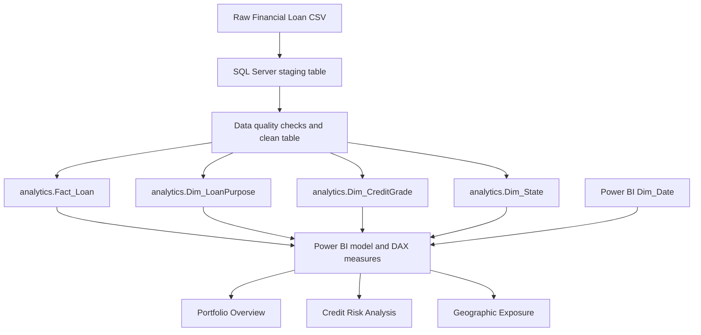

# Bank Loan Analytics — Portfolio Performance & Credit Risk Analysis

An end-to-end Data Analyst portfolio project using **Microsoft SQL Server, SQL, Power BI, and DAX** to evaluate a loan portfolio, compare historical charge-off patterns, and identify loan segments and geographic markets that merit further investigation.

The project is designed around business questions rather than charts for their own sake: **how is the portfolio performing, where is credit risk concentrated, and what should an analyst investigate next?**

> **Current implementation:** the included Power BI file contains three implemented report pages: Portfolio Overview, Credit Risk Analysis, and Geographic Exposure. The raw dataset's issue dates cover **2021-01-01 through 2021-12-12**, so a multi-year vintage analysis is not claimed as an implemented dashboard.

## Project at a glance

| Item | Result |
|---|---:|
| Loan records | 38,576 |
| Distinct loan IDs | 38,576 |
| Total loan amount | $435,757,075 |
| Average loan amount | $11,296.07 |
| Fully Paid loans | 32,145 (83.33%) |
| Charged Off loans | 5,333 (13.82%) |
| Current loans | 1,098 (2.85%) |
| Amount associated with Charged Off loans | $65,532,225 (15.04% of total loan amount) |
| Average interest rate | 12.05% |
| Average DTI | 13.33% |
| Issue-date range | 2021-01-01 to 2021-12-12 |

**Metric note:** the overall charge-off rate is calculated as `Charged Off loans / All loans`, so Current loans remain in the denominator. The $65.53M figure represents the original loan amount associated with charged-off accounts; it is **not** the lender's realized net loss after recoveries.

## Business problem

A lender needs to understand repayment outcomes, distinguish a high rate of charge-offs from a high absolute number of charged-off accounts, and identify loan segments or markets where closer monitoring may be worthwhile. Portfolio totals alone do not answer those questions. This project combines SQL-based analysis and a relational Power BI model to explore performance across **credit grade, loan purpose, loan term, and state**.

The dataset already contains an A–G credit-grade system. The analysis does not attempt to invent a replacement grading model; it investigates how observed outcomes, interest rates, DTI, loan volume, and loan amounts vary across the existing segments.

## Dashboard pages

### 1. Portfolio Overview

**Main question:** *What does the overall loan portfolio look like, and how do recorded outcomes and lending activity break down?*


**Included visuals and KPIs**
- Total Loans, Funded Amount (modeled as `SUM(loan_amount)`), Average Loan Amount, Fully Paid Rate, and Charge-Off Rate.
- Loan Status Distribution: Fully Paid, Charged Off, and Current.
- Total Loan Amount by Status.
- Monthly Loan Issuance & Amount.
- Top 5 Loan Purposes by Amount.

**What this page answers**
- What is the size of the portfolio?
- What proportion of loans is Fully Paid, Charged Off, or Current?
- How does the original loan amount differ across the three recorded statuses?
- How do loan count and loan amount vary across recorded issue months?
- Which loan purposes account for the largest lending amounts?

### 2. Credit Risk Analysis

**Main question:** *Which credit grades, loan purposes, and loan terms show higher historical charge-off rates, and how much lending exposure is associated with those segments?*


**Included visuals and KPIs**
- Charged-Off Loans, Charged-Off Amount, Average Loan Amount of Charged-Off Loans, and Charge-Off Rate.
- Loan Amount & Charge-Off Rate by Credit Grade.
- Credit Grade Risk Summary matrix with loan count, amount, Fully Paid count, Charged-Off count, and charge-off rate.
- Loan Amount & Charge-Off Rate by Loan Purpose.
- Loan Amount & Charge-Off Rate by Loan Term.

**What this page answers**
- How does the observed charge-off rate vary from Grade A through Grade G?
- Which purposes have higher charge-off rates, and which purposes represent the largest amount/count exposure?
- How do 36-month and 60-month loans compare?
- Which high-rate segments are large enough to merit priority investigation?

### 3. Geographic Exposure

**Main question:** *Where is lending concentrated, and which states combine material exposure with higher observed charge-off rates?*


**Included visuals and KPIs**
- Geographies Represented, Total Loans, Funded Amount, and Charge-Off Rate.
- US state map shaded by loan amount.
- Top 10 States by Loan Amount, with charge-off rate comparison.
- State Risk Summary table.
- State Risk Segmentation scatterplot comparing loan count and charge-off rate, with loan amount represented by bubble size.

**What this page answers**
- Where is lending exposure concentrated?
- Which states account for the largest total loan amounts?
- Which states have higher observed charge-off rates?
- Are higher rates occurring in states with many loans, substantial amounts, or small samples?

**Geography coverage note:** the source contains 50 distinct geographic entries: 49 states plus the District of Columbia. North Dakota is not represented. 

## Key findings from the supplied data

These are descriptive findings from the included CSV, using the definitions stated below. They are not causal claims or predictions of future losses.

### 1. Portfolio outcomes and exposure

- **32,145 loans (83.33%)** are Fully Paid, **5,333 (13.82%)** are Charged Off, and **1,098 (2.85%)** are Current.
- Charged-off accounts are associated with **$65.53M** in original loan amount, approximately **15.04%** of the portfolio's **$435.76M** total loan amount.
- The average original loan amount among charged-off accounts is approximately **$12,288.06**.

### 2. The existing credit-grade and interest-rate pattern

As the letter grade moves from A toward G, both the observed charge-off rate and average interest rate increase across this dataset. This pattern is consistent with **risk-based pricing**: riskier grade segments carry higher average interest rates. The data does not, by itself, prove that the pricing structure reduces net losses or quantify the causal effect of pricing.

| Grade | Loans | Charged-Off loans | Charge-Off rate | Average interest rate | Average DTI |
|---|---:|---:|---:|---:|---:|
| A | 9,689 | 552 | 5.70% | 7.35% | 12.04% |
| B | 11,674 | 1,343 | 11.50% | 11.03% | 13.43% |
| C | 7,904 | 1,266 | 16.02% | 13.55% | 13.92% |
| D | 5,182 | 1,072 | 20.69% | 15.71% | 13.98% |
| E | 2,786 | 691 | 24.80% | 17.71% | 14.10% |
| F | 1,028 | 311 | 30.25% | 19.74% | 14.17% |
| G | 313 | 98 | 31.31% | 21.40% | 14.06% |

**Interpretation:** Grade G has the highest observed rate, but only 313 loans. Grade B has the largest loan count, largest total loan amount (**$130.70M**), and largest charged-off count (**1,343**). So the segment with the highest *rate* is not the same as the segment with the highest *number of charged-off loans* or the greatest *amount exposure*.

Average DTI generally increases from Grade A through Grade F, then is slightly lower for Grade G. This is a broad pattern rather than a strictly monotonic relationship, and the project does not claim that DTI alone determines grade assignment.

### 3. Loan purpose: high rate versus high exposure

- **Small business:** 1,776 loans, 455 charged off, and a **25.62%** observed charge-off rate. This is the highest rate among the main purpose categories shown in the dashboard and deserves further investigation.
- **Debt consolidation:** 18,214 loans and **$232.46M** in loan amount—about **53.35%** of the portfolio amount. It has 2,651 charged-off loans and a **14.55%** charge-off rate. Its rate is below Small Business, but its scale means it accounts for the largest charged-off count among purposes.
- **Renewable energy:** 17 charged-off loans out of 94 loans (18.09%). The small sample means its percentage should be treated cautiously.

**Business implication:** investigate elevated-rate purposes such as Small Business, while also monitoring Debt Consolidation because of its much larger exposure. The purpose label alone does not explain why an individual loan was charged off.

### 4. Loan term: account for Current loans

| Term | Total loans | Charged-Off loans | Current loans | Charge-Off rate using all loans |
|---|---:|---:|---:|---:|
| 36 months | 28,237 | 3,023 | 0 | 10.71% |
| 60 months | 10,339 | 2,310 | 1,098 | 22.34% |

All **1,098 Current loans** in this dataset are in the 60-month group. Among resolved loans only (Fully Paid + Charged Off), the 60-month rate is **25.00%**, compared with **10.71%** for 36-month loans. The gap warrants investigation, but the mix of Current loans and differences in observation time mean it should not be interpreted as proof that term length itself causes charge-offs.

### 5. Geographic concentration and state-level risk

- California, New York, and Texas together account for **$151.80M**, or approximately **34.84%** of total loan amount.
- California is the largest market in this dataset: **6,894 loans**, **$78.48M** in loan amount, and a **15.33%** charge-off rate.
- Nevada has a **20.95%** charge-off rate across **482 loans**; Florida has a **17.27%** rate across **2,773 loans**.
- The supplied data also contains very small state samples. For example, a 60% rate based on five loans is not directly comparable with a rate based on thousands of loans. Loan counts must be considered alongside percentages.

**Business implication:** review both rate and exposure. A smaller state with a higher rate may require focused investigation, while a large state can matter because of the amount and number of loans exposed.

## How to use the slicers to investigate further

The report's slicers make the findings exploratory rather than fixed. Change one filter at a time, note the segment, and compare both the rate and the sample size.

Suggested investigations:

1. **Grade × Loan Purpose:** Does the elevated Small Business charge-off rate persist within the same credit grades, or is the purpose-level result partly explained by the mix of grades?
2. **Grade × Loan Term:** Does the 60-month versus 36-month difference remain when comparing loans in the same grade?
3. **State × Grade/Purpose:** Are states with higher rates concentrated in particular credit grades or loan purposes?
4. **Rate versus exposure:** Which segments have high charge-off rates *and* large loan amounts or charged-off counts? Which have high rates but few loans?
5. **Monthly activity:** How do the number and amount of recorded loans vary across issue months? The source issue dates end on 2021-12-12, so interpret December using the actual date coverage available.

These are investigative questions. Any resulting statement should be checked against the filtered visuals or exported data before being reported as a finding.

## Metric definitions

- **Good Loans:** `loan_status = 'Fully Paid'`.
- **Bad Loans / Charged-Off Loans:** `loan_status = 'Charged Off'`.
- **Current Loans:** `loan_status = 'Current'`; kept separate because a final repayment outcome is not recorded.
- **Charge-Off Rate (count-based):** `Charged-Off Loans / Total Loans`. The denominator includes Current loans and matches the report's overall **13.82%** KPI.
- **Charge-Off Amount Share:** `SUM(loan_amount for Charged Off) / SUM(loan_amount for all loans)` = **15.04%**. This is original loan amount associated with charged-off accounts, not realized loss after recoveries.
- **Average Loan Amount of Charged-Off Loans:** `SUM(loan_amount for Charged Off) / Charged-Off Loans` = approximately **$12,288.06**.
- **Funded Amount in the report:** currently calculated from `SUM(loan_amount)`. The source/model does not contain a separate `funded_amount` column, so the report label refers to the loan amount field.
- **Date coverage:** issue dates in the raw CSV run from **2021-01-01 to 2021-12-12**. The available dataset supports monthly analysis within 2021, not a genuine 2010–2015 vintage comparison.

## Data model and technical approach



The SQL scripts create the staging/cleaning workflow, dimension tables, fact table, and analytical queries. `Dim_Date` is created in Power BI for issue-date slicing and monthly aggregation. In the semantic model, the dimension keys relate to `Fact_Loan`; the date table relates to the fact table's issue date.

### SQL scripts

| File | Purpose |
|---|---|
| `SQL/01_Database_Creation_and_Data_Import.sql` | Creates `BankLoanAnalytics` and includes a staging-table inspection query. The CSV is loaded separately using the SSMS import workflow. |
| `SQL/02_Data_Cleaning_and_Transformation.sql` | Checks missing/blank values, duplicate loan IDs and types; creates the clean table and standardizes missing employee titles as `Unknown`. |
| `SQL/03_Dimension_and_Fact_Table_Creation.sql` | Creates Loan Purpose, Credit Grade, and State dimensions, then creates `Fact_Loan` with keys and loan attributes. |
| `SQL/04_Analysis_and_KPI_Validation.sql` | Validates core KPIs and status totals; analyzes credit grade, loan term, loan purpose, states, and monthly issue activity; includes data-quality checks. |

## Repository contents

```text
Bank-Loan-Analytics/
├── README.md
├── PowerBI/
│   └── Credit_Risk_Project.pbix
├── SQL/
│   ├── 01_Database_Creation_and_Data_Import.sql
│   ├── 02_Data_Cleaning_and_Transformation.sql
│   ├── 03_Dimension_and_Fact_Table_Creation.sql
│   └── 04_Analysis_and_KPI_Validation.sql
├── Data/
│   ├── Financial_Loan_Stagging.csv
│   └── README.md
└── Screenshots/
    ├── 01_Portfolio_Overview.png
    ├── 02_Credit_Risk_Analysis.png
    └── 03_Geographic_Exposure.png
```

## How to reproduce the project

1. Install SQL Server and SQL Server Management Studio (SSMS), plus Power BI Desktop.
2. Open and run `SQL/01_Database_Creation_and_Data_Import.sql` to create the `BankLoanAnalytics` database.
3. Use SSMS **Import Flat File** (or the import wizard) to load `Data/Financial_Loan_Stagging.csv` as `dbo.Financial_Loan_Stagging`. Check the date parsing and numeric data types during import.
4. Run `SQL/02_Data_Cleaning_and_Transformation.sql`.
5. Run `SQL/03_Dimension_and_Fact_Table_Creation.sql`.
6. Run `SQL/04_Analysis_and_KPI_Validation.sql` and compare the returned totals and segment results with the report.
7. Open `PowerBI/Credit_Risk_Project.pbix`, connect or refresh against your SQL Server database, verify relationships and date sorting, and check the KPI totals before publishing.

> The creation scripts were written for a clean project setup and are not all idempotent. If you have already created the tables, do not rerun the `CREATE`/`SELECT INTO` sections blindly; use a fresh database or carefully reset the existing objects first.

## Limitations and responsible interpretation

- The project is descriptive analysis of the supplied loan records. It does not prove causation, predict future defaults, or calculate net charge-off losses after recoveries.
- The 60-month group contains all Current loans in the dataset. Comparisons should disclose the denominator and consider differences in follow-up/maturity.
- Some state or purpose segments have small counts. Interpret rate extremes alongside volume and amount.
- The raw CSV includes `total_payment`, but the current fact-table creation script does not select it into `analytics.Fact_Loan`; therefore the current report does not claim to show Total Amount Received. That measure would require an updated fact table/model and validation.


## Deliverables

- Power BI report (`.pbix`) with three implemented dashboard pages.
- SQL Server database creation, data-cleaning, data-modeling, analysis, and KPI-validation scripts.
- The supplied raw CSV, subject to source license/redistribution permission.
- PNG screenshots of the three implemented report pages.

---

**Project focus:** use SQL and Power BI to turn loan-level records into validated portfolio metrics, segment comparisons, and defensible questions for business investigation.
